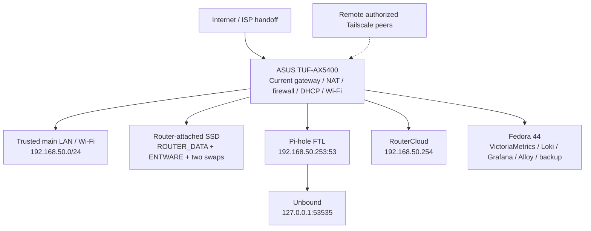

# ASUS Edge Gateway — current production architecture v1.2

**Edition:** 2026-10-15 / v1.2  
**Status:** DATED CURRENT-PRODUCTION ARCHITECTURE SNAPSHOT  
**Reference:** ASUS TUF-AX5400 / GNUton Asuswrt-Merlin `3004.388.11_1-gnuton1_tuf`; Fedora 44 for administration and observability.  
**Evidence boundary:** this edition incorporates the October 15 security worklog. It is **not** a fresh full production acceptance, blanket deployment instruction, gateway HA assertion or confirmation that locally tested PrivDrop is live.

> **Publication history:** [2026-10-13 PDF v1.1](ASUS-Edge-Gateway-Architecture-2026-10-13-v1.1.pdf) is retained unchanged as a dated historical record. This Markdown edition is the maintained v1.2 text. The corresponding generated PDF v1.2 is a separate release artifact and must not be linked here until its binary is actually committed to the repository.

## 1. Executive architecture

The ASUS is **the only production WAN gateway**, router, firewall, DHCP server and main Wi-Fi AP, and hosts the current local DNS/service stack. The router-attached SSD supports Entware, two active swap files and RouterCloud persistence. A separate Fedora 44 workstation hosts monitoring, logging, Grafana alerting and recovery tooling. The currently verified architecture is Home/SMB-style and **not** an HA network.

No managed switch, separate wireless controller, dedicated out-of-band console, redundant gateway, dual-WAN acceptance, measured UPS runtime or production Trusted/IoT/Guest VLAN-backed segmentation is documented. Do not infer any of these controls from the source-level design.

## 2. Address ownership and DNS

| Role | Reference address | Status |
| --- | --- | --- |
| Main LAN | `192.168.50.0/24` | CURRENT |
| ASUS gateway | `192.168.50.1` | CURRENT |
| Pi-hole listener alias | `192.168.50.253:53` | CURRENT |
| RouterCloud alias | `192.168.50.254` | CURRENT |
| Unbound local upstream | `127.0.0.1:53535` | CURRENT |

Three client/router DNS planes **must not be collapsed**:

1. **Main-LAN DHCP Pi-hole path**: DHCP clients receive the Pi-hole alias and reach FTL/Gravity, then Unbound for allowed external queries.
2. **Classic DNS interception**: other LAN/Tailscale TCP/UDP 53 destinations can be redirected through firmware `dnsmasq`, which forwards to **the same Unbound**, not automatically through Pi-hole. Filtering/attribution differs between the two front-ends.
3. **Router system resolver**: the deployed, bounded-live-validated DNS Guard v3.2 can use independent WAN bootstrap DNS in fail-open/break-glass conditions. This protects the router's **own resolver**; it is **not** client-facing automatic DNS failover and can bypass Pi-hole policy.

The project separately enforces/rejects selected classic IPv4 LAN DNS/DoT behavior; DoH, DoQ, VPN-borne and other encrypted DNS paths are not universally captured. [Canonical DNS diagram](dns-enforcement-flow.md).

**Issue [#212](https://github.com/wojko6/Advanced-ASUS-Edge-Gateway-ZTNA-Infrastructure/issues/212)** is **OPEN/PAUSED**, awaiting separately approved independent hardware. Neither two local listeners nor two DHCP DNS entries guarantee independent filtered client continuity. [Availability limitations](availability-and-redundancy.md).

## 3. ZTNA and management

Tailscale Grants implement the identity layer; project-owned `EDGE_TS_INPUT` / `EDGE_TS_FORWARD` apply separate router-local firewall policy, with `netfilter-mode=off`. Source-allowlisted remote router HTTPS uses the configured Tailscale TCP/8443 → local TCP/443 path. WAN source NAT remains platform-owned; RouterCloud, Pi-hole and Grafana are not intentionally exposed directly to WAN.

**Issue #176** remains open: router-local, source-specific allowlisting of exit-node forwarding has not yet been accepted. Trusted local wired/LAN management and physically available recovery remain important if Tailscale or DNS fails.

## 4. Boot dependencies and data

The current owner-managed `/jffs/scripts/post-mount` preserves **swap activation before AMTM**. AMTM/Entware then launches the Sxx services including syslog-ng, Tailscale, Unbound and FTL. DNS Guard schedules its watchdog before waiting for `/opt`, preserving a bootstrap/break-glass recovery path.

A successful service restart with present SSD is not equivalent to a blank-device restore. `#129` remains open for full Pi-hole-aware disaster recovery, correct service aliases, fresh resolver/name behavior and measured RTO/RPO.

## 5. Security — Issue #235 checkpoint (2026-10-15)

**Issue #235 OPEN. [Draft PR #245](https://github.com/wojko6/Advanced-ASUS-Edge-Gateway-ZTNA-Infrastructure/pull/245) DRAFT / UNMERGED / UNINSTALLED. PRODUCTION GO/NO-GO = HOLD.**

**SSD DAC and remount.** On October 14, separately authorized Stage 1 nonrecursive changes to `ROUTER_DATA` mount root `0777 → 0755` and `.routercloud-system` `0777 → 0700` passed bounded service/browser/backup checks. On October 15, read-only checks observed **both** ext4 SSD mount roots again at root:root `0777` after mounting; protected RouterCloud and Entware child directories and two swaps remained intact. Matching GNUton firmware source issues `chmod(mountpoint, 0777)` on mount before invoking `post-mount`. This supports the explanation but does not constitute a kernel execution trace. World-writable nonsticky mount roots pose a **local directory-entry integrity** risk even with protected `0700` descendants; this is not a demonstrated remote exploit.

**PR #245 preparation.** An exact allowlisted two-mount SSD mode repair candidate uses privately staged UUIDs, checks ext4 mount identity, numeric root owner/modes and secure JFFS parent chains, and preserves swap-before-AMTM on failure. A V3 private Fedora candidate passed pinned-byte comparison, `sh -n`, manifest and **Fedora-only atomic replacement/rollback simulation**. No private UUID/helper/live hook integration was installed on ASUS. Two scripts mentioning SSD paths require consumer classification; firmware, transient and dynamically formed paths are not fully excluded.

**PrivDrop ARMv7.** Local-only, operator-reported branch `security/issue235-privdrop-armv7` includes reported JFFS-7/JFFS-8/QEMU fixture PASS (UID/GID reduction, capability boundaries, source hashing and input rejection). This branch was **not pushed/merged/deployed** at this checkpoint. It has not established actual execution via `memfd` on the reference ASUS or production RouterCloud starting as non-root. The live RouterCloud/Dufs process was sampled as **root**.

**Origin isolation.** Synthetic custom-404 active-content findings and a separate trusted-assets candidate do not prove the live HTTP/user-file trust boundary has been repaired. HTML/SVG/XML/404/inline disposition/CSP/auth/preview regressions and safe backend behavior remain open.

**No unsafe installer.** A separate live custom `services-start` hook is owned by UID:GID 1000:1000, differing from managed source. **Do not use generic `scripts/install.sh`** for PR #245: it could rewrite that independent hook. Private JFFS file staging, activation and reboot require **separate explicit approvals** and verified rollback.

Full dated evidence: [Oct 14 worklog](../worklog/2026-10-14.md), [Oct 15 worklog](../worklog/2026-10-15.md), [Issue #235](https://github.com/wojko6/Advanced-ASUS-Edge-Gateway-ZTNA-Infrastructure/issues/235).

## 6. Observability and backup

Fedora 44 runs the external VictoriaMetrics/Loki/Alloy/Grafana/Blackbox and SSH/API collecting environment. Grafana has **15 standing alert rules** after removing a temporary synthetic E2E rule. A bounded test delivered Firing and Resolved through Gmail and Telegram; **all 15 alerts have not been independently exercised**, and #236 remains open for provisioning/contact persistence and per-rule acceptance. The Fedora host's unavailability removes visibility, not the ASUS routing dataplane.

The backup strategy includes encrypted off-router artifacts and previously validated targeted restores. Operator attestation of wired administrative access and a checked external encrypted original post-mount copy **does not** prove live-JFFS emergency restoration.

## 7. Current limitations and release gates

| Open item | Required acceptance |
| --- | --- |
| #235 SSD/JFFS | Writer review; exact staging; separate hook activation; actual reboot persistence; restore/rollback |
| #235 PrivDrop | Published source/CI; target ARMv7 binary/loader/privilege tests; RouterCloud functional regressions |
| #235 origin | Active-file/user-origin/404 hardening; browser and backend tests |
| #212 DNS failover | Suitable separate hardware; independent failover; DNSSEC/filter parity; no DNS loops |
| #129 DR | Pi-hole-aware clean-device restore and measured recovery |
| #143 VLAN zones | Actual capability, access/trunk mapping, firewall isolation and migration |
| #176 exit-node | Source-scoped router-local forwarding policy and negative tests |
| #236 alerting | Persistent provisioning/contact parity and individual rule tests |

No unspecified SSD changes, RouterCloud/Dufs release-candidate update, kernel/firmware migration, DNS experiment or reboot is authorized by this edition.

## 8. Platform decision and separated future concept

**Production authority, 2026-10-12:** keep ASUS TUF-AX5400; **cancel RT-BE88U migration**; consider OPNsense/x86 only as an unspecified future research/lab option. Current production remains unchanged.

**Design-only scenario, 2026-10-15:** the operator is considering a separate **GL.iNet Flint 4 gateway with ASUS as a services-only node**, without a mandatory switch, including a planned VLAN split and independent DNS fallback. There has been **no hardware purchase or migration approval**; it is described separately in [future Flint 4 + ASUS design](Flint4-ASUS-Future-Architecture-2026-10-15.md).

## Sources / document precedence

[Project status](../../PROJECT-STATUS.md) · [Network design index](../network-design.md) · [Physical topology](physical-topology.md) · [DNS enforcement](dns-enforcement-flow.md) · [Availability](availability-and-redundancy.md) · [Platform direction](platform-direction-2026-10-12.md) · [Boot dependency](boot-service-dependency-flow.md) · [Current Oct 15 worklog](../worklog/2026-10-15.md).

This is a dated **public architecture snapshot**. Private host identifiers, serials, UUID values, credentials and SSH keys are intentionally omitted. Detailed Markdown and issue evidence take precedence for more recent changes.
