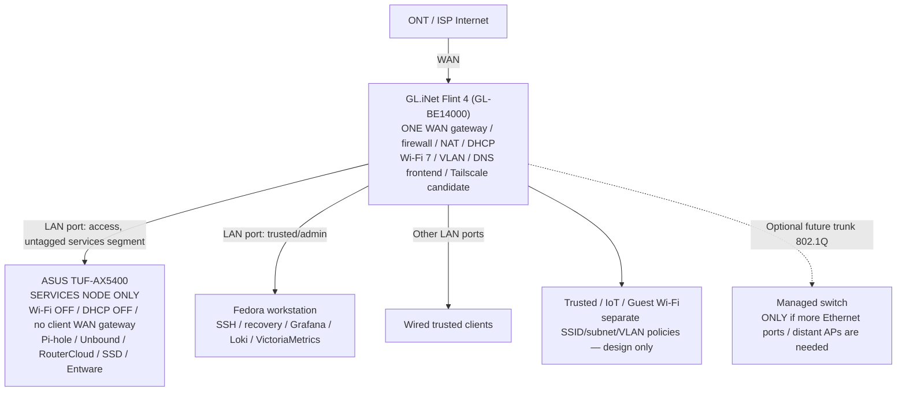

# Future Architecture — GL.iNet Flint 4 + ASUS service node

**Edition:** 2026-10-15 / future design v2.0  
**Status:** CONDITIONAL DESIGN / NOT PURCHASED / NOT DEPLOYED / NO CUTOVER AUTHORIZED  
**Current production remains:** ASUS TUF-AX5400, in accordance with the 2026-10-12 reference-platform decision.  
**Architecture distinction:** this is *not* the current ASUS v1.2 edition; it is a hypothesis to validate if the operator elects to acquire Flint 4.

> The diagram in this document intentionally **does not require a standalone managed switch**. Flint 4's documented VLAN and Ethernet access/trunk features make direct connection of the initial devices a reasonable design. Actual firmware/port/Wi-Fi VLAN mapping and isolation remain an acceptance gate.

## 1. Physical topology — initial deployment, no required switch

This is a **physical/logical planning diagram**, not proof of link negotiation, PoE support, a live LAN split, a documented switch purchase or Wi-Fi isolation on a specific installed firmware.

### Roles and boundaries

| Node | Proposed role | Must not be assumed |
| --- | --- | --- |
| Flint 4 | Single WAN router, firewall, DHCP, Wi-Fi, access/trunk VLAN policy, stable client DNS endpoint | Router HA, DNS failover implementation out of the box, reviewed Tailscale firewall parity |
| ASUS TUF-AX5400 | Pi-hole/FTL, Unbound, RouterCloud, data SSD/Entware/swap, optional restricted service management | Automatic conversion into safe generic AP mode; automatic JFFS/RouterCloud hardening |
| Fedora 44 | Monitoring, backups, SSH administration, rollback material and lab tests | Gateway dataplane HA |
| Managed switch | **OPTIONAL** for additional ports, remotely located APs, 802.1Q expansion and perhaps PoE if required | Initial prerequisite |

Manufacturer documentation supports Flint 4 VLAN subnet controls and Ethernet Port **Standard/Access Network** versus **Multiple VLANs** with tagged networks / native PVID. It also documents many physical LAN interfaces. Availability of each desired setting must be checked against the exact installed firmware and hardware revision; do not invent stable switch-port numbering from promotional specifications.

References:
- [Flint 4 official user guide](https://docs.gl-inet.com/router/en/4/user_guide/gl-be14000/)
- [GL.iNet Subnet interface](https://docs.gl-inet.com/router/en/4/interface_guide/subnet/)
- [GL.iNet Ethernet Port v4.10](https://docs.gl-inet.com/router/en/4/interface_guide/ethernet_port_v4.10/)

## 2. ASUS services-node conversion — planned steps only

- Attach **ASUS LAN to Flint LAN** on a designated **access/untagged** Services segment. Preserve reliable web/SSH management and the two currently used service addresses only after conflict-free address migration has been explicitly accepted.
- Disable ASUS Wi-Fi and its DHCP service **only after** a tested alternate management route and correct Flint DHCP are confirmed.
- Remove ASUS's client-edge responsibilities (WAN NAT, default-client routing) in a separately audited change; leave its own default route toward Flint for updates and outbound service dependencies.
- **Do not blindly enable ASUS AP mode**: it may alter hooks, interface layout, firewall and service startup, invalidating Entware, FTL, RouterCloud, alias and Tailscale assumptions.
- Preserve SSD ext4 identities, both swaps, Entware ordering and recovery checkpoint; no SSD migration is implied.

The safest variant is a deliberately configured, stable *service host* with no Wi-Fi and no LAN DHCP, not an additional home gateway in series.

## 3. Segmentation and firewall rules

VLAN IDs, network ranges, DHCP scopes and port assignments are **provisional**, not production values. Issue [#143](https://github.com/wojko6/Advanced-ASUS-Edge-Gateway-ZTNA-Infrastructure/issues/143) remains responsible for platform-neutral zone design. Candidate trust zones:

| Zone | Proposed policy |
| --- | --- |
| Management | Fedora/admin to selected Flint + ASUS management addresses, SSH/HTTPS as explicitly approved |
| Services | ASUS Pi-hole/Unbound/RouterCloud, strictly allowlisted consumers |
| Trusted | Client devices to Internet; required Services access; restricted management |
| IoT | Internet and selected local dependencies only; no arbitrary Trusted/Management |
| Guest | Internet only, client isolation, no access to internal Services/Management |

Test default deny, return-path policy, per-SSID VLAN mapping, IPv4/IPv6 parity, mDNS exceptions, multicast, Chromecast/printer paths, DHCP and Tailscale transit before declaring successful segmentation. An unused managed switch does not add security; a correctly configured router-enforced VLAN does.

## 4. DNS: two independent backend failure domains (unimplemented)

Preferred design goal: stable DNS frontend on **Flint 4** for clients, with:

1. **Primary backend:** ASUS Pi-hole/FTL, which forwards allowed queries to the ASUS Unbound.
2. **Independent secondary:** a Flint-resident resolver that can answer even if ASUS, its SSD, Pi-hole FTL or Unbound fails.

Required **independence** means backup queries do **not** loop back to Pi-hole/Unbound or depend on ASUS power/state. The exact frontend, proxy/health-check implementation, service identity and firmware integration remain **undecided**. Merely specifying `server=ASUS` with a timeout and local dnsmasq is not evidence of reliable automatic failover.

A proper acceptance harness must exercise UDP + TCP 53, hard failures and timeouts, stale/cache-masked answers, DNSSEC signed/bogus zones, no-DNS-loop assertions, rule policy parity, filter bypass visibility, failback hysteresis, TTL behavior, local/reverse naming, IPv6 RA/RDNSS, direct DoH/DoT/DoQ bypass and DNS leak prevention. The choice between emergency **fail-open** and strict filtering **fail-closed** must be made explicitly and documented.

**Important:** DNS Guard v3.2 is a current ASUS **system resolver** safeguard. It is not the above future Flint client DNS failover. #212 remains PAUSED until a separately approved hardware/research decision. Even an independent resolver on Flint does not eliminate **Flint as a single gateway/DHCP/client-DNS endpoint failure domain**.

## 5. Security issue #235 survives the gateway migration

Moving the WAN gateway role to Flint does **not** remove local SSD directory-integrity, RouterCloud root privileges or same-origin active-file risk on ASUS.

- Issue #235 remains OPEN, Draft PR #245 UNINSTALLED, production GO/NO-GO HOLD at this checkpoint.
- The source-controlled SSD mount-root hardening helper must still be staged and accepted separately from activation/reboot; preserve original `post-mount`, swap-before-AMTM and custom `services-start`.
- The local ARMv7 PrivDrop/QEMU fixtures are not an accepted nonroot ASUS deployment. Source integrity and service behavior still require real target acceptance.
- HTTP active-content / custom 404 / symlink / auth/preview isolation must be tested regardless of network segmentation.
- A router firewall segment can reduce exposure but does not replace application privilege separation.

See [current production v1.2](ASUS-Edge-Gateway-Architecture-2026-10-15-v1.2.md) and [Oct 15 security worklog](../worklog/2026-10-15.md).

## 6. Zero Trust and VPN migration

The existing ASUS-specific `iptables`, Tailscale `netfilter-mode=off`, `EDGE_TS_INPUT`, `EDGE_TS_FORWARD` and platform-owned NAT assumptions cannot be copied verbatim to Flint. Decide **which host owns** Tailscale connectivity and exit-node/subnet routes, and prove administrative source restrictions, private Routes/Grants, DNS integration, route precedence and fail-closed behavior with negative tests.

Maintain local wired management independently of Tailscale and local DNS during any migration. No new remote WAN management exposure is intended.

## 7. Isolated lab before any ONT handover

Possible stage: power up Flint at a desk **without ONT**, connect Fedora by Ethernet to a Flint LAN port, and leave Fedora Wi-Fi connected to the existing production network. The lab Ethernet profile must not unexpectedly become the Fedora default gateway or DNS resolver (e.g. configure `never-default` for the test profile). Prevent overlapping subnets and DHCP leaks into the existing LAN. Optional controlled WAN uplink from ASUS LAN to Flint WAN can supply lab Internet with **double NAT**, but is not production or proof that ISP/ONT cutover works.

No production ASUS DHCP, Wi-Fi, WAN, firmware, firewall, partition or hook settings should change during this lab.

## 8. Migration phases and acceptance

| Gate | Work | Acceptance / stop |
| --- | --- | --- |
| A — purchase decision | Confirm whether hardware will actually be acquired | Explicit user decision; otherwise design only |
| B — isolated Flint | Verify firmware, LAN, subnet, VLAN access and SSIDs without ONT | All test traffic stays off production |
| C — backup/DR | Record ASUS baseline, hashes, SSD/Entware, RouterCloud and DNS dependencies | Off-device rollback and direct recovery access |
| D — services-node lab | Test ASUS LAN-to-LAN, disable radio/DHCP only in a controlled isolated context | Pi-hole, Unbound, RouterCloud and admin access PASS |
| E — DNS | Implement a truly independent resolver and controller | UDP/TCP failure/failback matrix, no loops, policy reviewed |
| F — segmentation | Configure Management/Services/Trusted/IoT/Guest | Default deny and required exceptions proved |
| G — WAN rehearsal | Test ISP handoff and actual routing policy | No unexpected IPv6/VPN/DNS bypass; rollback prepared |
| H — separately approved cutover | Operator-led change with stable restore path | Service and client validation, monitoring, no stealth regression |

The architecture is intentionally **non-HA**: one Flint gateway, one ASUS service node, one Fedora observability host, and distinct power/storage dependencies. Unchanged access to ONT, independent DNS policy and backup are **required acceptance evidence**, not design guarantees.

## 9. Relation to older platform decisions

The 2026-10-12 platform document cancelled any **RT-BE88U** migration and treated OPNsense/x86 as undated research. The Flint 4 option was discussed **later** and remains a conditional, non-purchased design candidate. It does **not** silently override the production decision to keep TUF-AX5400 and finish CORE v1.0.

**Publication boundary:** this text and its companion future-oriented PDF v2.0 are design snapshots, not an approval to modify ASUS or Flint hardware.
