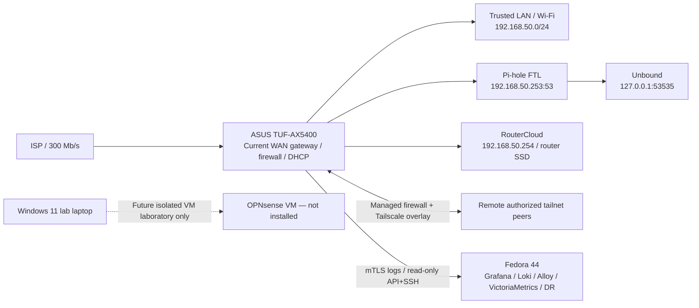

# Platform direction — current ASUS, optional future OPNsense

**Decision date:** 2026-10-12  
**Status:** CURRENT STRATEGIC DECISION / NO PRODUCTION MIGRATION APPROVED  
**Authority:** latest user decision, superseding older ASUS RT-BE88U target plans.  
**Reference production state:** ASUS TUF-AX5400 / GNUton Asuswrt-Merlin `3004.388.11_1-gnuton1_tuf`; last broad production reboot/healthcheck 2026-10-09, 0 failures and 0 warnings. An explicit new router live check was **not** performed during this decision.

## Decision

1. **Retain ASUS TUF-AX5400 as the production edge** and develop its existing [ASUS Edge Gateway](../../README.md) repository toward a well-evidenced **CORE v1.0**. This is an engineering milestone, **not a release already tagged or accepted**.
2. **Cancel the previously planned ASUS RT-BE88U migration.** It is **not** the target, not a planned purchase, and not an approved hardware upgrade. Prior model-specific reports, comparisons, and screenshots remain dated historical evidence or optional research, not the active roadmap.
3. **OPNsense/x86 is a possible future architecture, with no migration date, purchase approval, hardware selection or production configuration change.** The first activity, if pursued, is a small isolated virtual lab on a separate Windows 11 laptop; no virtualization stack is currently installed on that machine.
4. Do not freeze or archive the ASUS repository. Preserve **security fixes, reliability, recovery, observability, bounded RouterCloud work and documentation** while protecting the verified current deployment.
5. Keep all platform-dependent DNS client-failover experiments under [Issue #212](https://github.com/wojko6/Advanced-ASUS-Edge-Gateway-ZTNA-Infrastructure/issues/212) **OFF ROUTER**, with no authorized production pilot, NAT changes, standby listener, new kernel or scheduler disruption.

## Current deployment — unchanged

The diagram is a role-level representation, **not** a new live packet-path test. See [DNS Enforcement Flow](dns-enforcement-flow.md) for the validated Pi-hole versus dnsmasq interception paths, and [Availability and Redundancy](availability-and-redundancy.md) for single failure domains.

## Important unresolved boundaries

- **DNS Guard v3.2** is a production-accepted, bounded router-**system**-resolver bootstrap/fail-open mechanism; it is **not** client DNS failover. Pi-hole and firmware dnsmasq both depend on **the same Unbound** for ordinary external queries.
- **Issue #212** remains open: RC13J v0.41 passed a synthetic, Fedora-only routed-sidecar experiment but found that selected clients could contact its sidecar gateway directly. v0.42 read-only ASUS Linux 4.1.52 inventory did not prove netns, veth or TPROXY compatibility. See [draft PR #227](https://github.com/wojko6/Advanced-ASUS-Edge-Gateway-ZTNA-Infrastructure/pull/227) (unmerged). No production standby accepted.
- **DR #129**: current Pi-hole-aware blank-device restore, correct start ordering, dedicated alias, local naming, custom BusyBox tools backup, full downstream restore and measured RTO/RPO remain incomplete. Historic pre-Pi-hole recovery or offline 65-IPK reconstruction is not equivalent to full DR acceptance.
- **Monitoring**: 15 Grafana rules; on 2026-10-12 a synthetic temporary rule yielded real `Firing` and `Resolved` in both Gmail and Telegram (operator-confirmed); rule deleted, 15 remained in UI. The five DNS Guard-specific rules were **not each individually tested**. Grouping/anti-flap, provisioning-vs-live Email/Telegram drift and persistence after provisioning reload are open follow-ups **despite #178 currently closed**.
- **Trust boundaries**: no current Trusted/IoT/Guest VLAN segmentation, dual WAN, gateway HA, dedicated out-of-band management, or proven UPS runtime. Do not imply HA from DNS Guard or backups.

## CORE v1.0 completion order

1. **#129 disaster recovery** — backup coverage matrix and clean-room reconstruction on Fedora/off-router, without router faults.
2. **#196 DNS Guard hardening** — bounded helpers, locking, bootstrap validation, BusyBox 1.25.1 compatibility and separately authorized rollout.
3. **#142 / #213 / #214** — independent client-visible DNS, cache-resistant fresh recursion, lost-watchdog detection. **#139** configuration drift and **#140** client-identity hierarchy remain CORE observability.
4. **#176 Tailscale exit-node source allowlist** — after off-router static/private tests and explicit rollback.
5. **#194 baseline**, #143 platform-neutral trust-zone design, #108 DNS analytics, #68 encrypted DNS coverage; develop without inventing capabilities of either router.
6. Review open RouterCloud PRs and other work independently; do not treat an isolated preview as deployed software. Keep **#212 and #216** off-router research, not a prerequisite for safe CORE v1.0.
7. Treat existing Unbound `1.26.1-1`, Pi-hole, Grafana baseline, Tailscale and #200 permission acceptance as completed **within their documented scopes**, not queued as reinstallation tasks.

## Future OPNsense research — only if revisited

- Windows 11 Pro second laptop, confirmed 16 GiB RAM, one externally available USB Ethernet adapter. A single physical NIC is **not** a blocker for an isolated VM: WAN virtual NAT and a separate host-only/internal LAN provide multiple virtual interfaces.
- At the 2026-10-12 checkpoint **VirtualBox/Hyper-V laboratory setup is not installed or confirmed**. First work is AMD-V / Windows hypervisor preflight, then hypervisor installation (separate user action), then isolated OPNsense guest with a suggested 4 GiB RAM, 2 vCPU and a virtual disk. A lab configuration is **not** a supported production firewall placement or a guaranteed performance result.
- Keep lab DHCP/RA/NAT separated from the main LAN `192.168.50.0/24`; do not bridge the lab LAN to the home switch/Wi-Fi. Virtual WAN NAT can still reach home devices unless egress is additionally constrained: for destructive simulations use a **fully internal lab**.
- Compare OPNsense PF/Unbound, independent Pi-hole + independent Unbound, DNS frontend options and segmentation in lab. A single OPNsense frontend is still an SPOF. No DNS filtering parity, DNSSEC failure behavior, client attribution or automatic failover claim without controlled UDP/TCP tests.
- Do **not** reuse ASUS-specific `iptables` rules, JFFS hooks, Broadcom modules or Entware binaries directly on FreeBSD: their **policies and test acceptance goals**, not implementation syntax, may migrate.
- Future decision requires measured benefits, full failure matrix, restoration strategy, trusted physical WAN/LAN separation and operator approval. There is **no schedule** to replace ASUS.

## History and supersession

Pre-2026-10-12 reports referring to the RT-BE88U as the next gateway (including dated PDFs, benchmark plans, dated worklogs and historic roadmap snapshots) document the plan *at that time*. They should remain intact and carry historical value. This decision supersedes them as **current planning policy**. Do not rewrite historical measurements or falsely backdate this choice.

**Change boundary:** Documentation and optional issue descriptions only. No production firmware/kernel, DNS, firewall, DHCP, SSH, Tailscale, SSD, runtime or Fedora configuration modified.
