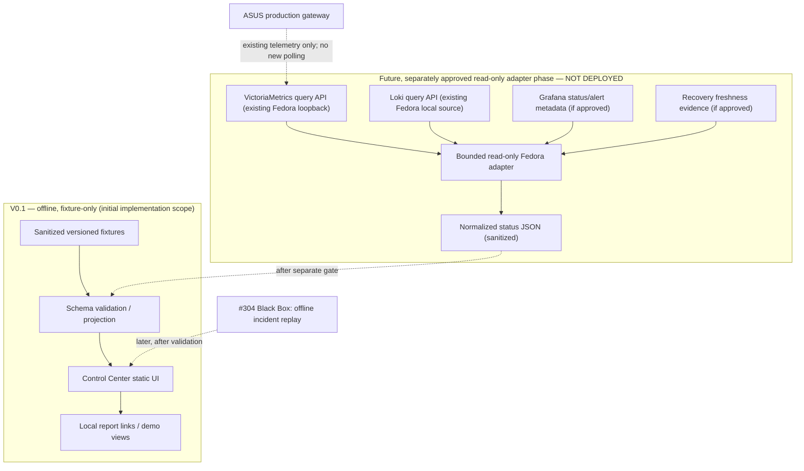

# Homelab Control Center — V0.1 architecture and UI contract

> **Historical lifecycle at initial design approval:** PLANNED / DRAFT — design-only checkpoint, before later implementation. This document records the original requirements and remains useful as an architectural baseline; its **Phase B NOT STARTED** and no-live-test claims are **superseded by separately merged work later on 2026-10-25**: V0.1 [PR #306](https://github.com/wojko6/Advanced-ASUS-Edge-Gateway-ZTNA-Infrastructure/pull/306), V0.2 [PR #307](https://github.com/wojko6/Advanced-ASUS-Edge-Gateway-ZTNA-Infrastructure/pull/307), and the **Fedora-local-only alias** [PR #308 evidence](homelab-control-center-local-https-alias-2026-10-25.md). The application still has **no authorized permanent production deployment**.
> **Date:** 2026-10-25.
> **Follow-up (2026-10-26):** after the original V0.1/V0.2 milestones, [#312](https://github.com/wojko6/Advanced-ASUS-Edge-Gateway-ZTNA-Infrastructure/pull/312) (V0.3 read-only DNS Guard/VictoriaMetrics adapter) and [#313](https://github.com/wojko6/Advanced-ASUS-Edge-Gateway-ZTNA-Infrastructure/pull/313) (DEMO fixtures hidden until opt-in) were **MERGED**. Dated Phase B `NOT STARTED` and prospective adapter statements below describe the initial design, **not** the present source state. The operator's bounded V0.3 browser/HTTPS tests passed but do not authorize a persistent application, autostart, wider listener or router changes. See [current lab usage](../../experiments/fedora/homelab-control-center-v0.1/README.md) and [project status](../../PROJECT-STATUS.md).
> **Primary issue:** [#303 — Homelab Control Center](https://github.com/wojko6/Advanced-ASUS-Edge-Gateway-ZTNA-Infrastructure/issues/303).
> **Separate module:** [#304 — Homelab Black Box](https://github.com/wojko6/Advanced-ASUS-Edge-Gateway-ZTNA-Infrastructure/issues/304).
> **Target environment:** Fedora 44 workstation/homelab; initial demonstration uses **sanitized offline fixtures only**.
> **Deployment gate:** **HOLD**. This document does not authorize installation, live data access, changes to services, or router contact.

## 1. Problem statement and boundaries

The Fedora host already has working observability services, but their statuses are spread across Grafana, Loki, VictoriaMetrics and individual service/backup checks. Operators need a **fast, everyday, read-only overview** of the current health and confidence of the infrastructure.

The Control Center will be a **consumer of existing evidence**, not a replacement for monitoring, alert rules, recovery tooling or service administration. In particular, it is distinct from the production ASUS-native WebUI [#84](https://github.com/wojko6/Advanced-ASUS-Edge-Gateway-ZTNA-Infrastructure/issues/84) and existing router-side entry portal [#141](https://github.com/wojko6/Advanced-ASUS-Edge-Gateway-ZTNA-Infrastructure/issues/141).

**Design principles:**

1. **Evidence before color:** `OK` requires a fresh, source-backed healthy observation; an unavailable source is `UNKNOWN` or `STALE`, not green.
2. **Read-only first:** no arbitrary command execution, service restarts, upgrades, router operations or auto-remediation.
3. **Fedora owns the application:** ASUS is a monitored system, never an application runtime or unapproved collector target.
4. **Privacy by default:** no identifiers, secrets, private dashboards, raw logs or operator directories in public fixtures, source or screenshots.
5. **One canonical producer per signal:** prefer the existing observability pipeline; do not recreate metrics/alert/backup collectors.
6. **Scope and proof are explicit:** offline fixture PASS cannot establish live topology coverage, service continuity or production readiness.

## 2. Proposed V0.1 architecture

The first executable slice is an **offline, static UI proof**. Only after its checks pass and the operator authorizes a separately scoped Fedora read-only preflight do we build a narrow, locally bound API layer.



**Important:** arrows in the future-adapter subgraph are **architectural proposals**, not confirmation that every listed endpoint is currently reachable with a suitable permission model or that an adapter exists. No router API login, SSH or change workflow is permitted in V0.1.

### Responsibility matrix

| Element | Owns | Does not own |
| --- | --- | --- |
| Control Center UI | Overview, source attribution, freshness, service detail cards, navigation | Monitoring collection, alert evaluation, production actions |
| Status projection | Schema validation, deterministic `status + reason + time`, sanitized presentation | Claiming unavailable evidence is healthy |
| Fixture store (initial) | Reproducible test cases for OK/failed/stale/unknown/offline | Real-time information |
| Candidate Fedora adapter (later) | Tight, explicitly allowlisted read-only queries and bounded caching | Router authentication, scripts, generic URL proxy, write endpoints |
| Existing VictoriaMetrics/Loki/Grafana | Measured metrics, logs and alerts within current accepted scope | Control Center UX state |
| #304 Black Box (later) | Evidenced incident chronology, attribution and uncertainty | Automatic root-cause certainty, repair, alert-rule changes |

## 3. Implementation direction and trade-offs

**Recommended V0.1:** TypeScript-free, dependency-light **static HTML + CSS + ES modules**, serving data from small **versioned JSON fixtures**. Source layout proposal:

```text
control-center-lab/
  README.md
  web/
    index.html
    css/
    js/
  schema/
    status.v1.schema.json
  fixtures/
    all-healthy.json
    dns-degraded.json
    telemetry-stale.json
    router-offline.json
    source-unavailable.json
  tests/
    fixtures-and-rendering/
```

**Why:** easiest offline review, small dependency/attack surface, fast rendering, accessible responsive layout; no backend, ports or new packages required just to review the design. An initial browser demo may be opened from local files or with a disposable user-level loopback-only static server after a separately reviewed lab command. Even a static UI must **not** auto-fetch external resources.

**Later (not selected/deployed):** a constrained **Python 3.14** read-only API adapter on Fedora is a reasonable candidate because the host already has Python. Framework and persistence choices are deferred until source/permissions inventory; `FastAPI` would add dependencies, while `http.server` is **not** a production-grade authenticated API. Do not add a server or privileged systemd service in the design stage. Long-running business logic and local credentials must never be stored in the browser.

**Storage:** no new time-series or log database. Initial fixtures live in the lab only. Later snapshot cache can be in-memory with explicit TTL and response-size bounds; any disk state, retention and backup policy need a separate decision.

**Application repository:** design tracked here with ASUS/Fedora observability architecture; a separate code repository/worktree for the application is preferred **subject to operator decision** before implementation. Do not place an unreviewed app in router installation directories or combine it with RouterCloud/DUFS branches.

## 4. User interface — four navigation sections

```text
┌──────────────────────────────────────────────────────────────────────┐
│ HOMELAB CONTROL CENTER   [Demo / Read-only]  Updated: <timestamp>   │
├──────────────┬───────────────────────────────────────────────────────┤
│ Overview     │ Health summary:  OK 4 | DEGRADED 1 | STALE 2         │
│ Services     │                                                       │
│ Incidents    │ [Fedora] [ASUS] [DNS] [Tailscale] [Observability]    │
│ Recovery     │ Each tile: verdict · last evidence · source · reason │
│              │                                                       │
│              │ Recent events:                                      │
│              │ <time>  source  status  evidence link                │
│              │                                                       │
│              │ Existing tools: Grafana | Pi-hole | ASUS | RouterCloud│
└──────────────┴───────────────────────────────────────────────────────┘
```

- **Overview:** small current-state grid (Fedora, ASUS, DNS Guard/Pi-hole/Unbound, Tailscale, monitoring pipeline) with signal age and provenance. **Never** use a mock-up as a screenshot of a real production state.
- **Services:** filtered component cards with `reason`, last observation, data source and optional **validated** link to an existing trusted service. Provide keyboard focus and screen-reader labels. No buttons pretending to perform restart/update.
- **Incidents:** V0.1 shows a clearly labelled **sample** event list or `No incident dataset loaded`. A real timeline and evidence-based correlation belong to [#304](https://github.com/wojko6/Advanced-ASUS-Edge-Gateway-ZTNA-Infrastructure/issues/304), not V0.1.
- **Recovery:** differentiate `last attempted backup`, `last successful backup`, `last integrity check`, `last isolated restore`, `last full boot restore` and `UNKNOWN`. A passing `restic check` or Btrfs `root receive` must **not** display `Fully recoverable`.

Display a persistent environment indicator: **DEMO / OFFLINE DATA** for initial fixtures. If any future live mode is enabled, use an explicit **LIVE READ-ONLY** indicator only after its acceptance, not by default.

## 5. Canonical status contract (proposal)

Status for each component must derive from evidence rather than from a manually colored tile. Example **synthetic** payload:

```json
{
  "schema_version": "1.0",
  "mode": "demo",
  "generated_at": "2026-10-25T12:00:00Z",
  "components": [
    {
      "id": "fedora-monitoring",
      "display_name": "Fedora monitoring",
      "status": "OK",
      "reason_code": "METRIC_FRESH_AND_HEALTHY",
      "reason": "Synthetic healthy observation for visual testing",
      "observed_at": "2026-10-25T11:59:45Z",
      "source_id": "fixture:up",
      "evidence_ref": "fixture://all-healthy/fedora-monitoring",
      "freshness_seconds": 15,
      "coverage": "synthetic",
      "quality": "fixture"
    }
  ]
}
```

Fields and semantics:

| Field | Meaning / constraint |
| --- | --- |
| `schema_version` | Explicit breaking-change/version policy; reject unknown major versions |
| `mode` | `demo` now; possible `live-readonly` only after approval and true source verification |
| `generated_at`, `observed_at` | UTC RFC3339 timestamps, separate rendering time from source observation |
| `status` | `OK`, `DEGRADED`, `DOWN`, `STALE`, `UNKNOWN`, `OFFLINE` |
| `source_id`, `evidence_ref` | Provenance for each verdict; no arbitrary user-supplied URLs |
| `reason_code`, `reason` | Stable machine reason plus display-safe explanation |
| `freshness_seconds` | Derived from source timestamp, never a fabricated freshness claim |
| `coverage`, `quality` | Explicit scope: synthetic, real bounded signal, partial or unavailable |

**Status decision order** (initial contract, thresholds not yet calibrated):

1. Invalid schema/time, nonexistent source or API failure -> `UNKNOWN`, never `OK`.
2. Known observation too old per documented per-source TTL -> `STALE`; don't reuse last green indefinitely.
3. `OFFLINE` only if a separately approved planned-offline schedule or explicit human annotation exists; an unreachable router alone is `UNKNOWN` (or `DOWN` if a *fresh independent* probe actually establishes failure).
4. Fresh, failed independent critical health signal -> `DOWN` or `DEGRADED` according to an explicit component policy, not by absence of a metric.
5. Fresh positive source-backed signals with required coverage -> `OK`. `up=1` means *the particular target responded*, not application-wide correctness.
6. Contradictory evidence -> `DEGRADED` or `UNKNOWN` with a reason and all relevant source timestamps, never silent majority voting.

**No fixed universal 30/60-second threshold.** Candidate TTLs must be derived from actual scrape/collection schedules, expected router power-off windows and query-path latency. A source being unavailable cannot be silently converted to `OFFLINE` based on time of day alone.

## 6. Existing source inventory and known coverage

| Proposed tile | Initial data | Live candidate (later only) | Coverage / warning |
| --- | --- | --- | --- |
| Fedora host | Fixture | Existing host metrics and approved service health | One process active does not imply all downstream functions |
| ASUS gateway | Fixture | Existing syslog/blackbox/metrics | Router may be intentionally powered off; distinguish unknown schedule from outage |
| Pi-hole / Unbound / DNS Guard | Fixture | Existing DNS Guard and Blackbox DNS signals | Router dnsmasq path != Pi-hole listener != every LAN/Tailscale client; do not collapse |
| Tailscale | Fixture | Existing bounded connectivity/health snapshots | Routing and DNS not proven by successful peer ping; deliberate `accept-routes=false` advisory is not an outage |
| Grafana / Loki / Alloy | Fixture | Existing status, alert metadata, Loki freshness | API `200` != working notifications; fresh Loki ingestion != complete log coverage |
| VictoriaMetrics | Fixture | Existing `up` and freshness metrics | Metrics depend on exporter/target and scrape continuity |
| Backup / restore | Fixture | Sanitized backup verification/restore checkpoint metadata | Four independently different states: backup, integrity, isolated restore and booted restore |

Existing references: [centralized logging](../centralized-logging.md), [Fedora observability maintenance](../operations/fedora-homelab-automatic-updates.md), [DNS visibility #108](https://github.com/wojko6/Advanced-ASUS-Edge-Gateway-ZTNA-Infrastructure/issues/108), [synthetic SLO checks #142](https://github.com/wojko6/Advanced-ASUS-Edge-Gateway-ZTNA-Infrastructure/issues/142), [Grafana delivery #236](https://github.com/wojko6/Advanced-ASUS-Edge-Gateway-ZTNA-Infrastructure/issues/236) and [backup freshness #261](https://github.com/wojko6/Advanced-ASUS-Edge-Gateway-ZTNA-Infrastructure/issues/261).

The 2026-10-25 operator-reported update/recovery checkpoint is documented in the [dated worklog](../worklog/2026-10-25.md). This does not make any of those observations a live input to the new application.

## 7. Security, trust boundaries and non-goals

```text
Public repository (reviewed code + sanitized fixtures)
        |
        v
Fedora non-root offline UI lab ─────X─────> ASUS production changes
        |                            X─────> local privileged commands
        |                            X─────> Grafana / Pi-hole credentials
        |
       FUTURE APPROVAL GATE
        |
        v
Fedora local read-only adapter (strict source allowlist, fixed queries)
        |
        +----> Existing loopback monitoring APIs (when authorized)
```

The **initial offline prototype must make zero external or production-network requests**: no third-party fonts, image CDN, browser telemetry, public APIs, service discovery, JavaScript package CDNs or live monitoring queries. If a disposable loopback-only static server is later used for local modules/fixture files, its localhost HTTP requests are strictly for those bundled assets; it must perform **no outbound requests** and must not be described as literally network-free.

For any **future** live adapter:

- Bind loopback only; prohibit wildcard binds, LAN/WAN/public exposure, Tailscale serve and Caddy reverse proxy until a dedicated access-control gate.
- Allow **fixed query templates** for approved local sources; never provide a generic API proxy, user-entered URL fetch, backend command execution, shell invocation, filesystem browser or control-plane endpoint.
- Explicitly prevent server-side request forgery, path traversal and accidental data exfiltration; fixed source addresses and timeouts, data-size bounds, conservative retries and error sanitization.
- Use a least-privilege non-root account or user-level process, no ambient capabilities, no service-specific admin secrets; **no token in rendered JSON or bundled JavaScript**. Any unavoidable read-only token must be stored via an approved server-side secret mechanism with revocation/rotation.
- Use text rendering (not untrusted HTML injection), restrictive Content-Security-Policy, accessibility checks and strict response schema. If live browser access is later enabled, separately review authentication, session fixation, CSRF boundaries and Tailscale visibility.
- Ensure no new frequent router SSD writes or new independent poller. Existing collector/backup ownership and all #235/#278/#287/#298/#299 gates remain unchanged.
- Avoid public publication of local addresses, MAC/client identifiers, detailed private host paths, user names, secret-bearing excerpts, raw router logs and full backup inventory.

## 8. Test strategy and measurable design acceptance

### Phase A — documentation (this PR)

- [x] Separate ownership from ASUS WebUI and RouterCloud.
- [x] Define V0.1 offline UI architecture, preliminary data contract, status semantics, failure modes and threat boundaries.
- [x] Define explicit future-gated ingestion and Black Box sequencing.
- [ ] Obtain operator review of architecture, code repository placement and UI priorities.

### Phase B — disposable offline UI prototype (NOT STARTED)

- [ ] Build demo with local sanitized data and **no external network calls**.
- [ ] Fixture test: all healthy; DNS degradation with IP path still healthy; stale telemetry; source unavailable; router offline by explicit annotation; contradictory sources.
- [ ] Verify schema rejection, timestamps, deterministic render ordering, clear DEMO indicator and honest freshness/status semantics.
- [ ] Verify no secret-pattern leaks, no malicious HTML execution, no outbound DNS/HTTP, no production files touched.
- [ ] Verify accessible keyboard navigation and narrow/mobile viewport layout. Record actual tests rather than hypothetical PASS.

### Phase C — Fedora read-only data connector (SEPARATE APPROVAL / HOLD)

- [ ] Inventory **actual** API endpoints, permissions, timestamp coverage, existing metric names, configuration ownership and confidentiality boundaries.
- [ ] Confirm separate non-mutating queries for representative sources with bounded data, timeout and provenance; no router contact, no network bind change.
- [ ] Test failures: timeout, HTTP 401/403, 5xx, malformed response, stale data, unpowered router, API partial outage.
- [ ] Review least privilege, release/update/backup/rollback and review any access beyond loopback **before** enabling recurring operation.

### Phase D — Black Box integration (SEPARATE ISSUE #304 / HOLD)

- [ ] Reuse #304's evidence schema, source-provenance and bounded offline October 24 incident fixture.
- [ ] Import only a sanitized and reviewed report into the Incidents view; no root-cause overclaim.

## 9. Decision log and open questions

| Decision | State |
| --- | --- |
| Host | Fedora 44 (proposed); **no running Control Center service** |
| First functional deliverable | Static, fixture-only, local read-only UI demo |
| Architecture | UI/projection boundary now; live adapter only after separate approval |
| Code location | **TBD** — separate application repository/worktree preferred, not router runtime |
| UI scope | Overview, Services, Incidents placeholder, Recovery |
| Source ownership | Existing monitoring and recovery records remain canonical |
| Authentication/access outside localhost | **NOT APPROVED** |
| Data retention / caching / framework for future API | **TBD after preflight** |
| ASUS, RouterCloud, DNS/firewall, Tailscale or alert changes | **NOT AUTHORIZED** |
| Production deployment | **HOLD** |

**Next suggested operator-reviewed action:** approve a bounded **offline UI prototype V0.1** in an isolated Fedora worktree/repository after choosing its source location. The design itself is not implementation acceptance.
